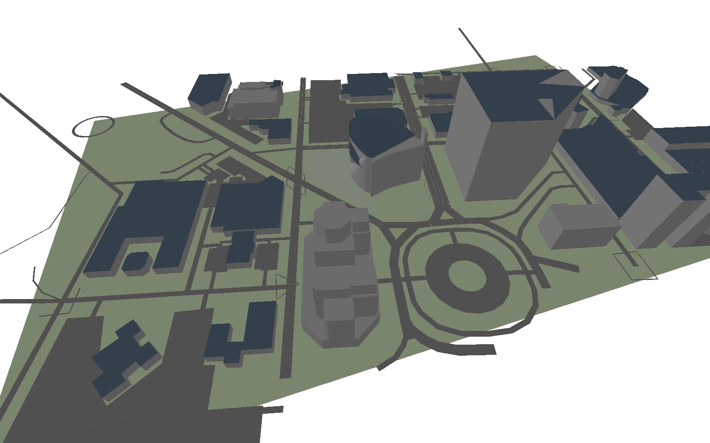

```{=html}
<div class="page-banner">
  
  <div class="hero-content">
    <div class="hero-eyebrow">iHuman Lab · Oklahoma State University</div>
    <div class="hero-title-top">iHuman Lab <span class="hero-title-accent">Presentations</span></div>
  </div>
</div>
```

```{=html}
<h2 class="section-heading">Lab tutorials &amp; outreach</h2>
<p class="section-sub">Decks the lab built together: tutorials, workshops and outreach.</p>
```

::: {#lab-decks}
:::

```{=html}
<h2 class="section-heading">Talks by lab members</h2>
<p class="section-sub">Research talks, defenses and conference presentations from individual students and PIs.</p>
```

::: {#people-decks}
:::
